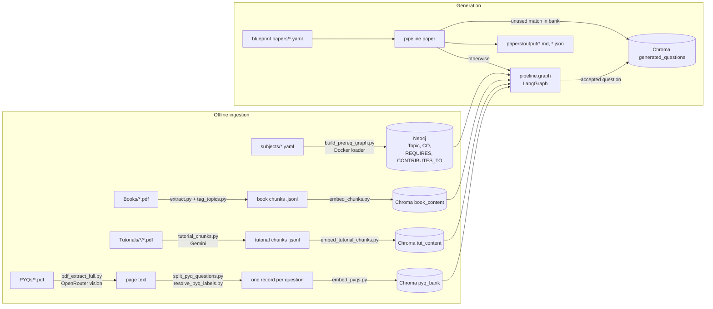
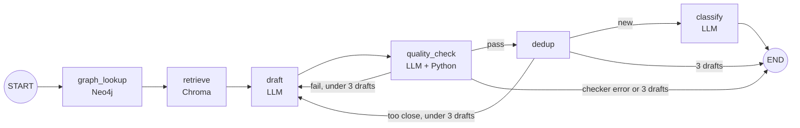

# AI Question Paper Generator

Generates college examination papers for a four-course undergraduate programming sequence. Each question is grounded in course books and tutorial sheets (RAG over ChromaDB). Its difficulty is set by a curriculum prerequisite graph (Neo4j). A LangGraph loop drafts, checks, de-duplicates and labels every question before the teacher sees it.

Built at Jaypee Institute of Information Technology, Noida (Integrated M.Tech CSE major project).

> **Status (commit `5a06403`, 25 Oct 2026).** Single-question generation (Phase 1) and whole-paper generation from a teacher's blueprint (Phase 2) are implemented and unit-tested. The web review screen and PDF printing (Phase 3) exist outside this branch and are **not in `main` yet**; see [Phase 3](#phase-3-not-yet-on-main). The system has **not yet been evaluated** against real papers or rated by faculty.

---

## Contents

1. [Problem and motivation](#problem-and-motivation)
2. [Features](#features)
3. [Architecture](#architecture)
4. [How one question is made](#how-one-question-is-made)
5. [How a whole paper is made](#how-a-whole-paper-is-made)
6. [Technology stack](#technology-stack)
7. [Repository structure](#repository-structure)
8. [Installation](#installation)
9. [Configuration](#configuration)
10. [Data](#data)
11. [Usage](#usage)
12. [Evaluation](#evaluation)
13. [Testing](#testing)
14. [Outputs](#outputs)
15. [Limitations and known issues](#limitations-and-known-issues)
16. [Phase 3 (not yet on main)](#phase-3-not-yet-on-main)
17. [Future work](#future-work)
18. [Contributors](#contributors)
19. [License](#license)

---

## Problem and motivation

Setting an exam paper by hand takes faculty a long time. The paper has to:

- cover the syllabus fairly
- hit a marks total and a difficulty mix
- map every question to a Course Outcome (CO)
- avoid repeating earlier papers
- be factually correct

A plain LLM prompt does none of this reliably. It invents facts, mislabels COs, repeats well-known questions and judges its own difficulty inconsistently.

This project addresses those problems in three ways:

- **Grounding.** Every question is drafted from retrieved book and tutorial text and then checked against it.
- **Structural difficulty.** Difficulty comes from *how far back in the prerequisite graph* a blended topic sits, not from asking the model to rate itself.
- **Deterministic checks.** Python, not the model, verifies arithmetic, marks totals and quoted evidence wherever possible.

**Scope.** Four courses, in prerequisite order:

| Graph id | Course | Semester | Book file |
|---|---|---|---|
| `SDF1` | Software Development Fundamentals I | 1 | `Books/SDF-1.pdf` |
| `SDF2` | Software Development Fundamentals II | 2 | `Books/SDF-2.pdf` |
| `DS` | Data Structures | 3 | `Books/DS.pdf` |
| `ALGO` | Algorithms and Problem Solving | 4 | `Books/APS.pdf` |

The intended user is a course instructor, who reviews every generated question before use.

---

## Features

### Implemented and unit-tested (on `main`)

| Feature | Where |
|---|---|
| Section-aware book chunking (PDF bookmarks, else font-size headings), text clean-up, chunks sized to the embedding model's window | `Extracting/extract.py`, `text_cleanup.py`, `token_budget.py` |
| Chapter → graph-topic tagging of book chunks | `tag_topics.py`, `Extracting/topic_map.yaml` |
| Tutorial sheets → one chunk per question, with diagram transcription (Gemini) | `Extracting/tutorial_chunks.py` |
| Past papers → page text (vision LLM via OpenRouter) → one record per question with CO, Bloom level, marks | `Extracting/pyqs_processing/` |
| Curriculum graph: topics, COs, CO Bloom levels, `hard`/`soft` prerequisite links, incl. cross-course links | `prerequisite_graph/` |
| Difficulty by graph distance (easy = no blend, medium = 1 hop, hard = 2+ hops) | `pipeline/difficulty_blend.py`, `nodes/graph_lookup.py` |
| Blend choice: when several prerequisites qualify, the one whose study material is closest to the main topic | `pipeline/nodes/retrieve.py`, `retrieval.py` |
| Retrieval from books + tutorials (tutorial places reserved), PYQs as style examples | `retrieval.py`, `nodes/retrieve.py` |
| LLM drafting with numbered sources, reply validated in Python (marks, parts sum, cited sources, no open results) | `pipeline/nodes/draft.py` |
| Quality check: claim-by-claim evidence, quotes verified in code, every calculation recomputed in Python, alternatives detection, *balanced* / *strict* grounding modes | `pipeline/nodes/quality_check.py`, `arithmetic.py` |
| Redraft loop with the checker's feedback (max 3 drafts) | `pipeline/graph.py` |
| Duplicate check vs past papers, tutorials and earlier generated questions (cosine similarity + shared 3-word phrases) | `pipeline/dedup.py` |
| Question bank (Chroma `generated_questions`): accepted questions saved, reused by later papers, marked as used | `pipeline/dedup.py` |
| CO and Bloom labelling of accepted questions; keyword-rule baseline | `pipeline/nodes/classify.py` |
| Classifier evaluation against the CO/Bloom labels printed on 53 real questions | `pipeline/eval_classify.py` |
| Teacher's blueprint (form, defaults from past papers, offline plan check) and whole-paper generation with resume | `pipeline/blueprint.py`, `pipeline/paper.py` |
| Paper and answer key as Markdown, with marks per CO and untested COs | `pipeline/paper.py` |
| Separate models for drafting and for checking/classifying (possibly on different services) | `pipeline/llm.py`, `settings.py` |

### Not implemented (described in the synopsis or earlier README)

- **Automatic paper-level balancing.** The planner *reports* marks per CO and warns about COs that no chosen topic can test. It does not swap questions to meet CO or difficulty targets.
- **Paper-level time check.**
- **Under-covered-topic suggestions.**
- **MCP servers.** Classification runs as a LangGraph node, not as an MCP server.
- **Redis.** The cache runs in `docker-compose.yml` but no Python code uses it. Question reuse goes through the Chroma question bank.
- **Qwen.** Not required. Any OpenAI-compatible model works; Qwen on OpenRouter is only the code default (see [Configuration](#configuration)).
- **GraphQL.** Not used. The graph is queried with Cypher through the Neo4j Python driver.

---

## Architecture

Two parts meet in the generation pipeline:

- **ChromaDB** answers *"what should this question be built on, and what should it look like?"*
- **Neo4j** answers *"what may the student be assumed to know, and what should be blended in for this difficulty?"*



The question loop in `pipeline/graph.py`:



The flags `--no-llm` (stop after retrieve), `--no-check`, `--no-dedup` and `--no-classify` remove steps from the graph.

---

## How one question is made

```bash
python -m pipeline.graph <TOPIC_ID> <easy|medium|hard> <marks>
```

1. **`graph_lookup`** (Neo4j). Loads the topic and its COs. It then lists prerequisites with their *shortest* hop distance and link strength, and picks blend candidates:
   - **easy**: no blend.
   - **medium**: a direct prerequisite (1 hop).
   - **hard**: 2+ hops, preferring an earlier semester.
   - Hard links win over soft ones.
2. **`retrieve`** (Chroma). Gathers the material for the draft:
   - Grounding text for the main topic and the blend topic, merged from `book_content` and `tut_content`, with places kept for tutorial questions.
   - Past questions of similar marks as style examples.
   - Earlier bank questions on the same topic. The writer is told to write something different, and those questions' sources are avoided.
   - If several blend candidates exist, the one whose text is closest to the main topic is chosen.
   - A topic with no grounding text is not sent to the model.
3. **`draft`** (LLM). Writes one question with parts and an answer outline, citing the numbered sources `[S1] [S2] …`. Python rejects and re-asks when:
   - the marks are wrong, or the parts don't add up to them
   - a main-topic or blend source isn't cited
   - an answer is left open (`= ?`, `TBD`)
4. **`quality_check`** (checker LLM + Python). The checker lists every fact in the question and in each answer line, with a quoted source. Code then decides:
   - A quote that isn't really in that source isn't believed.
   - Every written calculation is recomputed (`pipeline/arithmetic.py`).
   - Answer outlines offering alternatives fail.
   - Other required properties: one reading, answerable from the sources, work matching the marks, a blend that is really needed.

   Grounding modes (`GROUNDING`):
   - `balanced` (default): question facts must be quoted or judged standard course knowledge; the answer outline is a *draft* key.
   - `strict`: every knowledge claim is quoted.

   A fail goes back to `draft` with the feedback, up to 3 drafts.
5. **`dedup`**. A draft is too close if it reaches cosine similarity ≥ `DEDUP_SIMILARITY` (0.78), or shares ≥ `DEDUP_OVERLAP` (50%) of 3-word phrases, with a past paper, a tutorial question or a bank question. Too-close drafts go back to `draft`.
6. **`classify`** (checker LLM).
   - The model picks the CO from **all** the subject's COs, with one real example question per CO.
   - If its pick isn't one of the topic's COs, the topic's CO wins.
   - The printed Bloom label is **the CO's college-assigned level** (`co_levels` in the YAML), matching how the college's papers print it. The model's own Bloom reading is kept as a second opinion.
   - Difficulty is the one requested, not re-estimated.

Accepted questions are saved in the question bank unless `--no-save` is passed. One question costs roughly 20k tokens; this is a project-note estimate, not measured in this audit.

---

## How a whole paper is made

```bash
python -m pipeline.paper new                                # interactive form -> papers/<subj>_<exam>.yaml
python -m pipeline.paper check papers/example_ds_t1.yaml    # plan + problems: no AI, no Docker needed
python -m pipeline.paper make  papers/example_ds_t1.yaml    # generate; re-run to resume
```

**The blueprint.** The teacher gives subject, exam (`T1` | `T2` | `T3` = end semester), total marks, time, and per question: `topic`, `marks`, `difficulty`. The teacher doesn't give the CO; `classify` decides it. `new` offers defaults (time, marks) taken from the past papers.

**`check`.** Validates the plan against the subject YAML. It lists which COs each question *can* test, warns about COs no chosen topic maps to, and shows bank questions that could be reused when Chroma is running.

**`make`.** Goes slot by slot:
1. If an unused bank question has the same topic, marks and difficulty, it is reused at no token cost.
2. Otherwise the slot runs through the full question pipeline.
3. Progress is written after every question to `papers/output/<name>.json`. A run stopped by a rate limit or Ctrl+C resumes from the next slot; failed slots are retried.
4. At the end it writes the paper and the answer key, and prints marks per CO and any untested COs.
5. `--fresh` starts over; the bank keeps its questions.

---

## Technology stack

| Layer | Used | Notes |
|---|---|---|
| Language | Python 3.10+ | Tests verified on 3.13 in this audit |
| Orchestration | LangGraph (`langgraph>=0.2`) | Chosen for the redraft loop (backward edges) |
| Vector store | ChromaDB server `chromadb/chroma:1.5.9` (Docker), client `chromadb>=1.0` | Data persisted to `./chroma_data` → `/data` |
| Embeddings | `sentence-transformers`, `all-MiniLM-L6-v2` (384-dim) | Same model must be used for embedding and querying |
| Graph DB | Neo4j 5 (Docker), Python driver `neo4j>=5.20`, Cypher | Loader runs as a one-off Compose service |
| LLM access | `openai` client against any OpenAI-compatible endpoint | Code default: OpenRouter `qwen/qwen3.8-27b:free`. Project runs used Groq `openai/gpt-oss-120b` (drafting) + Gemini `gemini-3.1-flash-lite` (checking/classifying) |
| Extraction | PyMuPDF, Pillow, `google-genai` (tutorials), OpenRouter vision model (PYQs), `groq` (model listing only) | Only needed to re-extract source PDFs |
| Other | PyYAML, tqdm, python-dotenv | |
| Also in Compose | Redis 7 | Started, but not used by any Python code |

---

## Repository structure

```
Question_Paper_Generator/
├── Books/                    4 textbook PDFs (APS, DS, SDF-1, SDF-2)
├── Tutorials/{APS,DS}/       tutorial sheet PDFs (5 APS, 10 DS; none for SDF-1/SDF-2)
├── PYQs/                     10 past exam papers (T1/T2/end-term, all four courses)
│
├── Extracting/               PDFs -> text
│   ├── extract.py            books -> section-aware chunks
│   ├── text_cleanup.py       ligatures, maths symbols, running headers, reference lists
│   ├── token_budget.py       chunk size rule (fits the embedding model's 256-token window)
│   ├── tutorial_chunks.py    tutorials -> one chunk per question (+ diagram transcription, Gemini)
│   ├── topic_map.yaml        book chapter -> graph topic_id
│   ├── .cache/               Gemini response cache
│   ├── pyqs_processing/
│   │   ├── pdf_extract_full.py      PYQ PDF -> page text (OpenRouter vision)
│   │   ├── split_pyq_questions.py   page text -> one record per question
│   │   ├── resolve_pyq_labels.py    cleans Bloom / CO / topic labels (preview, then --write)
│   │   ├── sample_pyq_search.py     sample similarity search
│   │   └── model_search.py          lists Groq models
│   └── Processed/            all processed data (committed)
│       ├── <book>_chunks.jsonl, <subj>_tutorial_chunks.jsonl
│       ├── pyq_pages/        page text per paper
│       └── pyq_structured/   <SUBJ>_<year>_<exam>_pyq.json, one record per question
│
├── Embedding/
│   ├── embed_chunks.py           -> Chroma book_content
│   ├── embed_tutorial_chunks.py  -> Chroma tut_content
│   ├── embed_pyqs.py             -> Chroma pyq_bank
│   └── stale_vectors.py          removes vectors whose chunk no longer exists
│
├── prerequisite_graph/
│   ├── subjects/{sdf1,sdf2,ds,algo}.yaml   topics, COs, CO levels, prerequisites (source of truth)
│   └── loader/                             build_prereq_graph.py + Dockerfile (YAML -> Neo4j)
│
├── pipeline/
│   ├── graph.py              the LangGraph question pipeline + CLI
│   ├── state.py              the state passed between nodes
│   ├── nodes/                graph_lookup, retrieve, draft, quality_check, classify
│   ├── difficulty_blend.py   hop-distance queries and blend rules
│   ├── dedup.py              duplicate check, question bank, calibration CLI
│   ├── arithmetic.py         recomputes calculations written in a draft
│   ├── curriculum.py         subject YAMLs read from disk (COs, CO levels)
│   ├── blueprint.py          the teacher's paper plan: form, defaults, validation
│   ├── paper.py              whole paper from a blueprint: reuse, generate, resume, render
│   ├── eval_classify.py      classifier vs printed PYQ labels
│   ├── llm.py                LLM client: JSON replies, retries, rate limits, token counts
│   └── resources.py          opens Neo4j / Chroma / embedding model once (injected into nodes)
│
├── papers/                   blueprints (*.yaml); output/ holds generated papers and keys
├── eval_results/             saved classifier answers (classify_<model>.jsonl)
├── tests/                    unit tests with fake Neo4j / Chroma / LLM (22 files)
├── diagrams/                 ingestion.png, generation.png (original design from the synopsis)
├── retrieval.py              grounding + PYQ retrieval helpers
├── tag_topics.py             adds topic_id to book chunks
├── settings.py               reads config: terminal env, else .env, else default
├── check_chroma.py           collection counts + topics with no grounding text
├── check.py                  older quick count of book/tutorial vectors
├── docker-compose.yml        neo4j + chroma + redis, and the loader (tools profile)
├── requirements.txt
└── .env.example
```

---

## Installation

You need Docker (Desktop or Engine) and Python 3.10+. Run everything from the repository root.

```bash
python -m venv .venv
source .venv/bin/activate          # Windows: .venv\Scripts\activate
pip install -r requirements.txt    # sentence-transformers pulls in PyTorch (large, first time only)
cp .env.example .env               # Windows: copy .env.example .env  -- then fill it in

docker compose up -d                                   # Neo4j, Chroma, Redis (bound to 127.0.0.1)
docker compose --profile tools run --rm loader         # load subject YAMLs into Neo4j
#   add --reset after removing or renaming anything in a YAML

python Embedding/embed_chunks.py            # books     -> book_content
python Embedding/embed_tutorial_chunks.py   # tutorials -> tut_content
python Embedding/embed_pyqs.py              # PYQs      -> pyq_bank
python check_chroma.py                      # verify, and list topics with no grounding text
```

The processed chunk files are committed, so **you don't need to re-extract the PDFs or have any API key** to build the databases. The embed scripts upsert and can be re-run.

Neo4j browser: <http://localhost:7474> (user `neo4j`, password from `.env`).

> **Chroma persistence.** Current Chroma images store data in `/data`, not the older `/chroma/chroma` path used in many tutorials. The compose file mounts `./chroma_data:/data`; with the wrong path, vectors are lost when the container is removed.

---

## Configuration

All settings are read by `settings.py` in this order: the terminal environment, then `.env`, then the default. `.env` is git-ignored. **Never commit real keys.**

| Variable | Default | Used for |
|---|---|---|
| `NEO4J_URI` / `NEO4J_USER` / `NEO4J_PASSWORD` | `bolt://localhost:7687` / `neo4j` / `yourpassword` | Graph; the password is also read by Docker Compose |
| `CHROMA_HOST` / `CHROMA_PORT` | `localhost` / `8000` | Vector store |
| `LLM_BASE_URL` / `LLM_MODEL` / `LLM_API_KEY` | OpenRouter / `qwen/qwen3.8-27b:free` / `OPENROUTER_API_KEY` | Drafting model (any OpenAI-compatible service) |
| `LLM_CHECK_MODEL` / `LLM_CHECK_BASE_URL` / `LLM_CHECK_API_KEY` | empty = the drafting model | Quality check + classify. A different model on another service catches more errors and has its own free quota |
| `LLM_TIMEOUT` | `180` | Seconds per reply |
| `LLM_REASONING_EFFORT` | `low` | `low` \| `medium` \| `high` \| `default` for reasoning models |
| `GROUNDING` | `balanced` | `balanced` \| `strict` |
| `DEDUP_SIMILARITY` / `DEDUP_OVERLAP` | `0.78` / `0.5` | Duplicate thresholds. Calibrate with `python -m pipeline.dedup --calibrate` |
| `OPENROUTER_API_KEY` | | PYQ page extraction; fallback drafting key |
| `GEMINI_API_KEY` | | Tutorial extraction |
| `GROQ_API_KEY` | | `model_search.py` only |

`pdf_extract_full.py` and `model_search.py` don't read `.env`; set their key in the terminal (PowerShell: `$env:OPENROUTER_API_KEY = "..."`).

The `.env.example` notes record a calibration result. On 21 Oct, different real questions had similarity of at most 0.72, while a rod-cutting question with new numbers reached 0.81; 0.78 sits between them.

---

## Data

| Data | Files | Size (counted in this audit) | Role |
|---|---|---|---|
| Book chunks | `Extracting/Processed/{APS,DS,SDF-1,SDF-2}_chunks.jsonl` | 9,708 chunks (APS 3,148 / DS 3,976 / SDF-1 919 / SDF-2 1,665) | Grounding facts |
| Tutorial chunks | `Extracting/Processed/{APS,DS}_tutorial_chunks.jsonl` | 94 (APS 30, DS 64) | Grounding at syllabus level; duplicate check |
| Past questions | `Extracting/Processed/pyq_structured/*.json` | 10 papers, 53 labelled questions | Style examples, duplicate check, classifier evaluation |
| Curriculum | `prerequisite_graph/subjects/*.yaml` | 30 topics, 48 prerequisite links (35 hard, 13 soft; 17 cross-course), 19 COs | Graph, blending, CO labels |

**Formats**
- **Book chunk:** `chunk_id`, `subject`, `source_file`, `section_title`, `page_start`, `page_end`, `text`, `topic_id` (added by `tag_topics.py`).
- **Tutorial chunk:** one question with `topic_ids` and `cos`.
- **PYQ record:** `id`, `document` (question text), `metadata` (subject, CO, Bloom level, marks, year, topic, source).

**Grounding gaps.** These topics have no book or tutorial text, so they can't be drafted:
- `SDF1_01`
- `SDF2_05` (UML)
- `SDF2_07` (SQL)

**CO text.** The DS COs and levels match the CO table printed on the 2024 T1 paper (see the comment in `ds.yaml`). Check the other subjects' CO statements against the official syllabus before real use.

**Re-extracting** (only when PDFs or extraction code change):

| Step | Command | Output |
|---|---|---|
| Books → chunks (no key, ~30 s) | `python Extracting/extract.py` | `Processed/<book>_chunks.jsonl` |
| Tag chunks with topics | `python tag_topics.py` | adds `topic_id` |
| Tutorials → chunks (Gemini) | `python Extracting/tutorial_chunks.py` (check: `--verify`) | `Processed/<subj>_tutorial_chunks.jsonl` |
| PYQ PDFs → page text (OpenRouter) | `python Extracting/pyqs_processing/pdf_extract_full.py` | `Processed/pyq_pages/` |
| Page text → questions | `python Extracting/pyqs_processing/split_pyq_questions.py` | `Processed/pyq_structured/` |
| Clean labels | `python Extracting/pyqs_processing/resolve_pyq_labels.py` then `--write` | updates JSON and `pyq_bank` |

`split_pyq_questions.py` overwrites `*_pyq.json`, so hand fixes are lost. Use `--out-dir` to compare first. Re-run the matching embed script after any re-extraction.

---

## Usage

Neo4j and Chroma must be running unless a command says otherwise.

```bash
# one question
python -m pipeline.graph ALGO_06 hard 10
python -m pipeline.graph DS_03 medium 5 --show-prompt            # also print the prompt
python -m pipeline.graph DS_03 medium 5 --no-llm --show-prompt   # stop before the model: no key, no cost
python -m pipeline.graph DS_03 medium 5 --no-check               # classify the first draft unchecked
python -m pipeline.graph DS_03 medium 5 --no-classify            # stop after the checks
python -m pipeline.graph DS_03 medium 5 --no-dedup --no-save     # no duplicate check, don't bank it
python -m pipeline.graph DS_03 medium 5 --grounding strict --max-drafts 2

# a whole paper (see "How a whole paper is made")
python -m pipeline.paper new
python -m pipeline.paper check papers/example_ds_t1.yaml          # works without Docker
python -m pipeline.paper make  papers/example_ds_t1.yaml [--fresh] [--max-drafts N]

# question bank and duplicate thresholds
python -m pipeline.dedup --calibrate
python -m pipeline.dedup --list [--subject DS]
python -m pipeline.dedup --remove <ID> ...
python -m pipeline.dedup --clear
```

The output prints:
- the blend topic and why it was chosen
- every source used
- each draft and its check report, including which facts came from model knowledge, for the reviewer
- the classification
- the tokens spent

---

## Evaluation

### Classifier vs printed labels (RQ2)

`python -m pipeline.eval_classify` labels the 53 PYQs and scores them against the CO and Bloom labels printed on the papers. It needs no Docker. The classifier never sees the question's topic, and its example questions exclude the one being labelled. Answers are saved per question in `eval_results/classify_<model>.jsonl`, so a stopped run resumes.

```bash
python -m pipeline.eval_classify --baseline        # keyword rules: no model, instant
python -m pipeline.eval_classify                   # LLM_CHECK_MODEL, else LLM_MODEL
python -m pipeline.eval_classify --subject DS --limit 5 [--fresh] [--model ID]
```

Metrics: CO accuracy and Cohen's kappa (labels namespaced per subject), Bloom-label accuracy, the model's own Bloom reading (exact, within one level, kappa), per-subject scores and a confusion matrix.

| Classifier | Saved answers | CO right | CO kappa | Bloom label right | How verified |
|---|---|---|---|---|---|
| Keyword baseline | current code | 26/53 (49%) | 0.46 | 31/53 | **Re-run in this audit** |
| `openai/gpt-oss-120b` | prompt v2 | 33/53 (62%) | 0.60 | 33/53 | Recomputed from the saved file in this audit |
| `openai/gpt-oss-120b` | prompt v1 | 34/53 (64%) | 0.62 | 27/53 | Recomputed from the saved file |

The model results need care:

- **The current classifier is prompt v3, and no v3 answers are saved.** `eval_classify.py` only scores answers made with the current prompt version. So `python -m pipeline.eval_classify` will query the model again and its numbers may differ. The gpt-oss figures above describe the earlier prompts, not the current code.
- **The model-vs-baseline difference has not been shown to be significant.** The project notes record McNemar p = 0.12, which is not significant at the usual 0.05 level. This audit did not rerun that test.
- **52 of the 53 printed Bloom labels equal their CO's level.** This is a property of the college's papers, and it is why the pipeline prints the CO level as the Bloom label.
- `eval_results/classify_qwen-qwen3.8-27b.jsonl` holds only 12 answers, so it is not a full run.

### Not yet run

- Paper-level comparison of generated papers with real papers (RQ3)
- Faculty ratings of generated questions (RQ4)
- Any measurement of whether graph blending changes *perceived* difficulty

No result in this repository yet shows that the generated questions are better, harder or more valid than a baseline.

---

## Testing

```bash
python -m unittest discover -s tests -t .
```

These are **unit tests**. Neo4j, Chroma, the embedding model and the LLM are replaced by fakes, so they need no Docker, no API key and no `sentence-transformers`.

**Verified in this audit:** 477 tests, all passing, on commit `5a06403` with Python 3.13.

The 22 test files cover:
- extraction and text clean-up
- PYQ splitting, labels and PII removal
- topic tagging and embed/stale-vector sync
- settings
- difficulty blending and blend fit
- draft parsing, quality-check decisions and arithmetic
- dedup
- classify
- the paper planner
- the LangGraph wiring (`test_phase1.py`)

There are **no integration tests** against live Neo4j/Chroma and **no end-to-end tests** with a real model. Generation quality is evaluated separately (see [Evaluation](#evaluation)).

---

## Outputs

| Output | Location |
|---|---|
| One-question run | printed to the terminal; accepted question saved in Chroma `generated_questions` |
| Paper progress (resumable) | `papers/output/<blueprint>.json` |
| Question paper | `papers/output/<blueprint>.md` |
| Answer key (a draft to check) | `papers/output/<blueprint>_key.md` |
| Classifier answers | `eval_results/classify_<model>.jsonl` |

`papers/output/example_ds_t1.*` is a committed sample: a 20-mark, 1-hour DS T1 paper with 4 generated questions, labelled CO2, CO3, CO4 and CO4. It was generated by an earlier run; this audit did not regenerate it.

---

## Limitations and known issues

- **Ungroundable topics.** `SDF1_01`, `SDF2_05` and `SDF2_07` can't be drafted. There are no tutorial chunks for SDF-1 or SDF-2.
- **Answer keys are drafts.** In `balanced` mode answer facts aren't quoted, and the checker (a small model in the project's runs) can miss contradictions. A bare result with no working shown can't be recomputed.
- **References the student can't see.** On `main`, drafts can still say "as described in the textbook (Section 8.2)" or "after line 8 of the algorithm"; the sample paper's Q2 does both. Phase 3 adds a rule against this.
- **No length limit on `main`.** The sample Q4 (6 marks) is long.
- **The hard tier can blend very basic topics.** For example, the sample's hard AVL question blends C `scanf`/`printf` control flow from SDF-1. Whether such topics belong in the hard tier is an open design decision.
- **No paper-level constraint solving.** CO coverage is reported, not enforced. Bloom labels follow the chosen CO.
- **Free-tier limits.** With Groq's free tier (8k tokens/min, 200k tokens/day) about 10 questions fit in a day; the paper planner resumes across days.
- **Model ids change.** Free model ids on OpenRouter come and go. `llm.py` reports a wrong id clearly; pick a current one.
- **Redis is unused.** The service is in `docker-compose.yml` with no consumer.
- **`requirements.txt` grouping.** It lists `openai` under "extraction", but `pipeline/llm.py` needs it for generation too.
- **Security.** Chroma and Redis have no authentication, and the default Neo4j password is public. Ports are bound to `127.0.0.1`; keep them that way unless you set real passwords.

---

## Phase 3 (not yet on main)

A third phase was built after `5a06403` but **is not in this branch**, so it couldn't be inspected or tested in this audit. According to the project notes, it adds:

- **A local web app** (`python -m pipeline.web`, <http://localhost:8765>, `WEB_PORT`). It provides:
  - a list of exam papers and a new-paper form
  - live progress per question
  - per-question review: approve, edit (with Python re-checks), or write a new one with a reason
  - PDF download
  It uses only the standard library and listens on 127.0.0.1 only.
- **Printing in the college format** (`pipeline/printout.py`, `python -m pipeline.paper pdf`). The paper header follows the college's PYQs: the UFM line, the Name/Enrollment box, course title and code, the CO table with printed codes and levels, and tags like `[C210.2 (Apply Level), 4 Marks]`. The answer key adds marks per CO, Bloom level and difficulty. Rendering is HTML → headless Chrome (`CHROME_PATH`) or the browser's Save as PDF. Printing requires every question approved (`--unreviewed` overrides).
- **Stricter draft rules:**
  - no textbook, section, figure or line references
  - at most 80 + 30 × marks words
  - every term defined
  - no "(S2)" citations left in the text
  - numbered tasks must be split into parts
- The notes report 522 passing tests for Phase 3.

Update this section from the code once Phase 3 is pushed.

---

## Future work

From the project notes. All of these are planned, not built:

1. Grounding text for SQL, UML and SDLC, and refusing ungroundable slots in `paper check`.
2. A paper-level time-feasibility rule.
3. Suggestions for least-assessed or under-covered topics.
4. Paper-level evaluation against the real PYQ papers (RQ3).
5. A faculty rating sheet exported from the review data (RQ4).
6. Possibly, narrow fine-tuning for output format only, not for curriculum content.

---

## Contributors

| GitHub | Name | Roll no. |
|---|---|---|
| [@AsmiVaish](https://github.com/AsmiVaish) | Asmi Vaish | 23803006 |
| [@vihantandon](https://github.com/vihantandon) | Vihan Tandon | 23803015 |
| [@riya19verma](https://github.com/riya19verma) | Riya Verma | 23803022 |

Supervisor: Dr. Ankita Verma, Department of Computer Science & Engineering, JIIT Noida.

## License

No license file is present, so the license is **unspecified**: by default, all rights are reserved by the authors. The textbook PDFs in `Books/` and the college papers in `PYQs/` belong to their respective rights holders.
